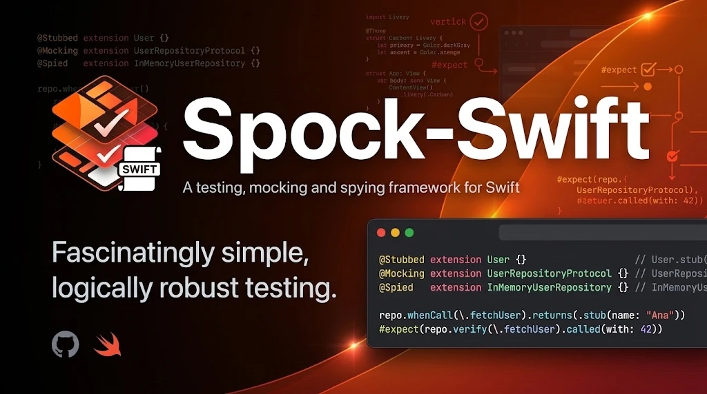

# 🖖 SpockSwift 2



[](https://github.com/fsaldivar-dev/experimental-test-tool-swift/issues)
[](https://github.com/fsaldivar-dev/experimental-test-tool-swift/stargazers)
[](https://github.com/fsaldivar-dev/experimental-test-tool-swift/blob/main/LICENSE.md)


🌐 **English** · [Español](README.md)

> ⚠️ **Beta.** The design is proven (91 tests, green CI) but the maturity is not: it is maintained by a single person and has not been used outside this repository yet. It runs on **macOS and Linux** with Swift Package Manager (CI on both). Read the [limits](AGENTS.md#l%C3%ADmites-no-intentar) before adopting it for anything critical.

Test doubles for Swift inspired by **Spock** (Java/Groovy): you declare what you need in your tests with an annotation, and `spock-gen` writes the **stubs**, **mocks** and **spies** as versioned files next to the tests. Your domain stays untouched, your test target builds with no build-tool plugins, and the syntax is the same to program and to verify:

```swift
@Stubbed extension User {}                   // User.stub(name: "Ana")
@Mocking extension UserRepositoryProtocol {} // UserRepositoryMock()
@Spied   extension InMemoryUserRepository {} // InMemoryUserRepositorySpy(real)

repo.whenCall(\.fetchUser).returns(.stub(name: "Ana"))
#expect(repo.verify(\.fetchUser).called(with: 42))
```

> The full reference (testing guide, library comparison, per-annotation reference) is in the [Spanish README](README.md). This English version covers the essentials; the deeper sections are being translated.

## ⚡ Quick Start

**1. Dependency** in your test target's `Package.swift` (Swift 6.1+). No `plugins:`.

```swift
.testTarget(
    name: "MyFeatureTests",
    dependencies: [
        "MyFeature",
        .product(name: "SpockSwift", package: "experimental-test-tool-swift")
    ]
)
```

**2. Annotate** in your tests which doubles you need. The domain is never touched.

```swift
import Testing
import SpockSwift
@testable import MyFeature

@Stubbed extension User {}                   // User.stub(...) with autoTree for its children
@Mocking extension UserRepositoryProtocol {} // UserRepositoryMock with whenCall / verify
```

**3. Generate** once. With the SwiftPM layout:

```bash
swift run spock-gen --sources Sources --tests Tests
```

A `Tests/MyFeatureTests/Generated/` folder appears, one file per type, mirroring the source layout. Commit it.

**4. Write the test** with the system under test, its doubles, and three blocks: Given, When, Then.

```swift
@Suite("UserService")
struct UserServiceTests {

    private func makeSUT() -> (sut: UserService, repo: UserRepositoryMock) {
        let repo = UserRepositoryMock()
        return (UserService(repository: repo), repo)
    }

    @Test("returns the formatted name of the user the repository provides")
    func displayName() async throws {
        // Given
        let (sut, repo) = makeSUT()
        repo.whenCall(\.fetchUser).returns(.stub(name: "Jhonatan", role: .admin))

        // When
        let displayName = try await sut.getUserDisplayName(id: 42)

        // Then
        #expect(displayName == "Jhonatan (admin)")
        #expect(repo.verify(\.fetchUser).called(with: 42))
    }
}
```

**5. Run.**

```bash
swift test
```

The `Example/` in this repo is exactly this, with a users domain, run with `swift test --filter Example`.

## 🧪 How the tests work

The doubles are **versioned snapshots**, not code regenerated on every build.

| Moment | What happens |
| --- | --- |
| You write `@Stubbed`, `@Mocking` or `@Spied` on an empty extension in tests | Nothing yet: the macro expands to nothing, it only marks intent |
| You run `spock-gen` | It reads the domain with swift-syntax and writes one file per type into `Generated/` |
| You build and run the tests | The test target compiles `Generated/` like any other folder. No plugins, no swift-syntax in the test graph |
| The domain changes | `spock-gen check` catches it in CI; `spock-gen` regenerates, and the PR diff shows which signature changed |

**Why a generator and not just macros.** An attached macro only sees the declaration it is written on. On `extension User {}` it cannot see `User`'s properties, and on `extension Interface {}` it cannot see the protocol's requirements. The only way to read the domain from the tests without annotating the domain is a generator. And the only way for that generator not to cost anything on each build is to version its output.

## 📚 Annotations

### `@Stubbed`

```swift
@Stubbed extension User {}

let user = User.stub()                               // sensible deterministic defaults
let custom = User.stub(name: "Francisco", pet: .stub(name: "Firulais"))
let three = User.stubs(count: 3)                     // distinct ids and indexed texts
```

Generates `static func stub(...)` with one parameter per property and a deterministic default chosen by name and type (`name` → `"Ana García"`, `email`, `createdAt` → a fixed date, `id` → `1`), plus `stubs(count:)`. autoTree generates the child types. `--defaults plain` keeps the flat values.

### `@Mocking`

```swift
@Mocking extension UserRepositoryProtocol {}

let repo = UserRepositoryMock()
repo.whenCall(\.fetchUser).returns(.stub(name: "Ana"))     // fixed value
repo.whenCall(\.fetchUser).returns { id in .stub(id: id) } // from the parameters
repo.whenCall(\.save).throws(MyError())                    // throwing methods only
```

Generates `<Protocol>Mock` (the `Protocol` suffix is dropped) with one mocked call per requirement. Three verbs to program — `run`, `returns`, `throws` — and `verify` to check.

### `@Spied`

```swift
@Spied extension InMemoryUserRepository {}

let spy = InMemoryUserRepositorySpy(InMemoryUserRepository(users: [.stub(id: 10)]))
_ = try await UserService(repository: spy).load(id: 10)    // runs the real code
#expect(spy.verify(\.fetchUser).called(with: 10))
```

Generates `<Type>Spy`: conforms to the domain protocols the type adopts, wraps the real instance, records every call and **always** delegates. It only spies, it never stubs.

## ✅ Verify (mocks and spies)

```swift
mock.verify(\.fetch).called()
mock.verify(\.fetch).called(times: 2)
mock.verify(\.fetch).called(with: 42)              // requires Equatable
mock.verify(\.save).called(where: { $0.user.id == 10 })  // tuples / predicate
mock.verify(\.save).last                           // last parameters
mock.verify(\.fetch).history                       // all, in order
mock.verify(\.fetch).count
```

## 🛠️ Commands

| Action | Command |
| --- | --- |
| Generate | `swift run spock-gen --sources Sources --tests Tests` |
| Check for drift (CI) | `swift run spock-gen check --sources Sources --tests Tests` |
| Clean generated | `swift run spock-gen clean --sources Sources --tests Tests` |
| Plain defaults (`dummy_`/0) | add `--defaults plain` |
| Named modules | `--sources App=path --tests AppTests=path` |

For AI agents, see [AGENTS.md](AGENTS.md).

## 📦 Migrating from v1.0.0

The v1 API (the `SpockDummy` protocol, `.dummy()`) and CocoaPods were removed in Spock 2 (SwiftPM only). v1.0.0 stays available at its tag. See the [Spanish README](README.md#-migrar-desde-v100) for the migration table.

## 👤 Author and license

Created by **Francisco Javier Saldivar** ([LinkedIn](https://www.linkedin.com/in/fsaldivar-dev))
Licensed under the **MIT License**.
